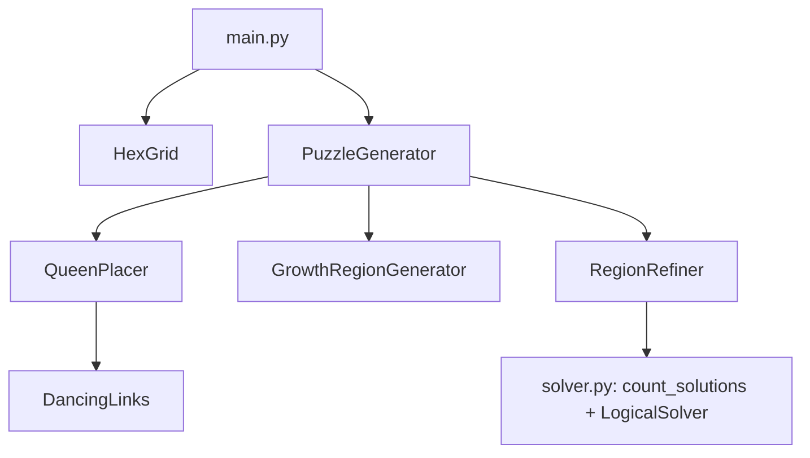

# HexQueen Project

A hexagonal grid puzzle generator and solver.

Key features include puzzle generation based on radius, ensuring puzzle validity, **guaranteed unique solutions**, and **guaranteed logical solvability** (with a difficulty rating). The project supports multiple output formats, including PNG images, PDF documents, and JSON data for application integration.

## Play It

The `web/` folder is a complete, dependency-free browser game:

```bash
python run.py --play          # serves web/ on http://127.0.0.1:8000 and opens it
```

(Any static file server works too, e.g. `python -m http.server -d web`.)

- **Daily puzzle** with a streak. Like a newspaper crossword it is gentlest on Monday and hardest on Saturday.
- **Endless puzzles** at four levels, generated in the browser in a few milliseconds:

  | Level  | Board            | Needs                                  |
  |--------|------------------|----------------------------------------|
  | Easy   | radius 3, 7 queens  | last-spot and boxed-in deductions   |
  | Medium | radius 4, 9 queens  | + crossfire (shared attacks)        |
  | Hard   | radius 5, 11 queens | + locked pairs                      |
  | Expert | radius 6, 13 queens | + locked trios/fours or a short "what if?" |

- **Hints that teach**: each hint names the deduction, highlights the cells involved and can apply it.
  Mistakes (a wrong queen, a crossed-out solution cell) are pointed out first.
- Tap to cycle × / queen, drag to mark many ×, undo/redo, auto-cross, clash highlighting, a timer,
  statistics, keyboard play, light and dark themes, and progress that survives reloads.
- **Shareable puzzles**: every puzzle has a code such as `hard-k3x9qa`; the same code always builds the same board.
  Click the code under the board to copy it or to type in a friend's. Opening the page with `#hard-k3x9qa`
  also works when the game is not embedded.
- **Python puzzles**: Settings → *Play a puzzle from the Python generator* accepts a `puzzle.json`.

Engine: `web/js/hexqueen-core.js` (geometry, exhaustive solver, human-style logical solver, generator).
Tests: `node --test web/test/core.test.js`.

### Publishing on itch.io

```bash
python run.py --package       # writes dist/hexqueen-web.zip (index.html at the root, licence included)
```

Upload the zip as an HTML project and tick "This file will be played in the browser". An embed of
about 960×800 with "Mobile friendly" and the fullscreen button enabled suits the layout. itch.io runs
the game in a cross-origin iframe, so the page URL is not shareable; players share puzzle codes
instead. Set `HOME_URL` in `web/js/game.js` to the itch.io page so shared results link back to it.

### How the web generator works

1. Pick a random non-attacking queen layout (the hidden solution).
2. Grow a region around each queen with uneven growth rates, so sizes vary like hand-made boards.
3. Hill-climb on region boundaries. Each candidate is scored by (extra solutions, cells the capped
   logical solver can't resolve, too-easy flag), and moves that don't make it worse are kept.
4. The logical solver always uses the easiest technique that works, so the hardest one it needed
   is the difficulty. A puzzle is accepted only when it is solvable with the level's techniques
   *and* needs the level's hardest one. Several candidates are made and the most interesting kept.

Solving to completion by deduction proves the solution is unique; the exhaustive solver double-checks.

## How Puzzles Are Generated (Python)

1. **Queens** - `QueenPlacer` (DLX) picks a random non-attacking layout: the hidden solution.
2. **Regions** - `GrowthRegionGenerator` grows one contiguous region around each queen.
3. **Refinement** - `RegionRefiner` hill-climbs on region boundaries, scoring each edit with the solvers
   until the puzzle has exactly one solution *and* can be solved by deduction alone.
   (Random regions alone are unique only ~1 time in 60 at radius 5; refinement succeeds essentially always.)
4. **Rating** - `LogicalSolver` reports the hardest deduction needed (set size *k*, 1 = easy ... 4 = hard),
   stored as the optional `difficulty` field in the JSON.

## Solving Approach

HexQueen uses **Knuth's Algorithm X** with **Dancing Links (DLX)** to solve hexagonal puzzle configurations. The solver treats each potential piece placement as a "row" and each no-conflict constraint (e.g., row, diagonal, or hex-line) as a "column" in an **exact-cover** matrix.

The DLX engine systematically selects rows (placements) so that each constraint column is covered exactly once—thereby guaranteeing no two pieces attack each other. This framework can be extended to more general region and adjacency constraints on hex boards beyond just "queens."

## Project Documentation

### Architecture Overview
Component relationships visualized through key interactions:



Detailed architecture documentation:
[docs/architecture/region_generator_architecture.md](docs/architecture/region_generator_architecture.md)

### Requirements Structure
Organized using hierarchical Markdown documentation:

```
docs/
├── requirements/
│   ├── index.md               # Requirements portal
│   ├── 100-199_Overview.md    # High-level project vision
│   ├── 200-299_Functional/
│   │   ├── 210_Puzzle_Generation.md
│   │   ├── 215_DLX_Solver.md
│   │   ├── 220_Output_Formats.md
│   │   └── 230_JSON_Specification.md
│   ├── 300-399_Non-functional.md # Performance & constraints
│   └── 400-499_Constraints_Assumptions.md
└── architecture/
    └── region_generator_architecture.md # Core system design
```

### Key Documentation Links
- [Functional Requirements](docs/requirements/200-299_Functional.md)
- [DLX Solver Implementation](docs/requirements/200-299_Functional/215_DLX_Solver.md)
- [Output Format Specifications](docs/requirements/200-299_Functional/220_Output_Formats.md)
- [JSON Schema Documentation](docs/requirements/200-299_Functional/230_JSON_Specification.md)
- [Architectural Decisions](docs/architecture/region_generator_architecture.md)

### Getting Started
```bash
# Install dependencies
pip install -r requirements.txt

# Generate a unique, logically solvable puzzle (writes PNGs + puzzle.json)
python run.py --radius 5 --generate-puzzle --seed 1 --max-difficulty 3

# Run the tests
python -m unittest discover tests
```

## License

The project's original code and original assets are licensed under the [MIT License](LICENSE).
Third-party dependencies, libraries and assets keep their own licences and notices. Anything the
project redistributes is listed with its licence text in [THIRD-PARTY-NOTICES.txt](THIRD-PARTY-NOTICES.txt)
(currently nothing); the audit and the policy for adding new material are in
[docs/third-party-licenses.md](docs/third-party-licenses.md).
