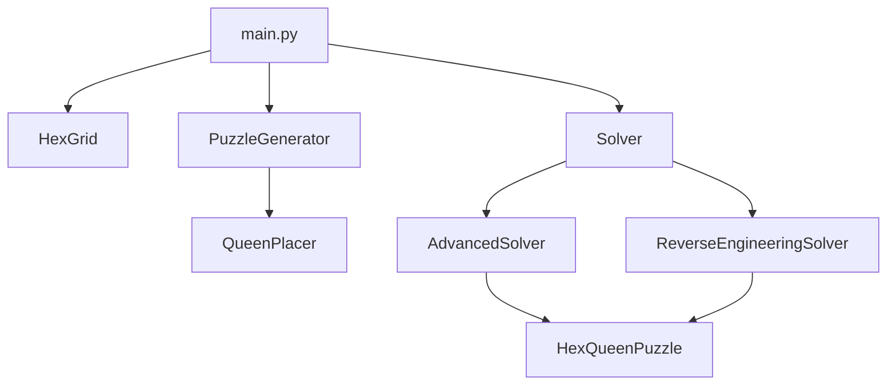

# HexQueen Project

A hexagonal grid puzzle generator and solver.

Key features include puzzle generation based on radius, ensuring puzzle validity, unique solutions, and logical solvability. The project supports multiple output formats, including PNG images, PDF documents, and JSON data for application integration.

## Project Documentation

### Architecture Overview
Component relationships visualized through key interactions:



Detailed architecture documentation:
[docs/architecture/region_generator_architecture.md](docs/architecture/region_generator_architecture.md)

### Requirements Structure
Organized using hierarchical Markdown documentation:

```
docs/
├── requirements/
│   ├── index.md               # Requirements portal
│   ├── 100-199_Overview.md    # High-level project vision
│   ├── 200-299_Functional/
│   │   ├── 210_Puzzle_Generation.md
│   │   ├── 220_Output_Formats.md
│   │   └── 230_JSON_Specification.md
│   ├── 300-399_Non-functional.md # Performance & constraints
│   └── 400-499_Constraints_Assumptions.md
└── architecture/
    └── region_generator_architecture.md # Core system design
```

### Key Documentation Links
- [Functional Requirements](docs/requirements/200-299_Functional.md)
- [Output Format Specifications](docs/requirements/200-299_Functional/220_Output_Formats.md)
- [JSON Schema Documentation](docs/requirements/200-299_Functional/230_JSON_Specification.md)
- [Architectural Decisions](docs/architecture/region_generator_architecture.md)

### Getting Started
```bash
# Install dependencies
pip install -r requirements.txt

# Generate and solve a puzzle
python src/main.py --radius 5 --output-format json
```