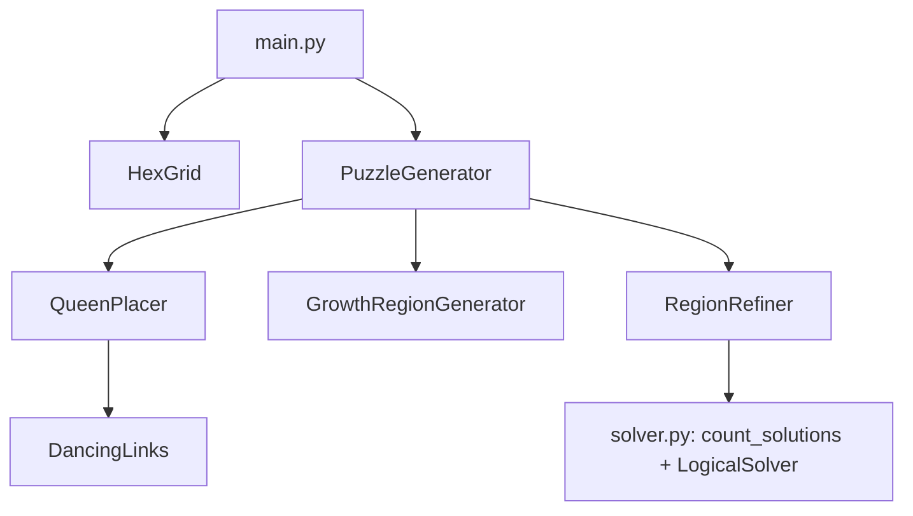

# HexQueen Project

A hexagonal grid puzzle generator and solver.

Key features include puzzle generation based on radius, ensuring puzzle validity, **guaranteed unique solutions**, and **guaranteed logical solvability** (with a difficulty rating). The project supports multiple output formats, including PNG images, PDF documents, and JSON data for application integration.

## How Puzzles Are Generated

1. **Queens** - `QueenPlacer` (DLX) picks a random non-attacking layout: the hidden solution.
2. **Regions** - `GrowthRegionGenerator` grows one contiguous region around each queen.
3. **Refinement** - `RegionRefiner` hill-climbs on region boundaries, scoring each edit with the solvers
   until the puzzle has exactly one solution *and* can be solved by deduction alone.
   (Random regions alone are unique only ~1 time in 60 at radius 5; refinement succeeds essentially always.)
4. **Rating** - `LogicalSolver` reports the hardest deduction needed (set size *k*, 1 = easy ... 4 = hard),
   stored as the optional `difficulty` field in the JSON.

## Solving Approach

HexQueen uses **Knuth's Algorithm X** with **Dancing Links (DLX)** to solve hexagonal puzzle configurations. The solver treats each potential piece placement as a "row" and each no-conflict constraint (e.g., row, diagonal, or hex-line) as a "column" in an **exact-cover** matrix.

The DLX engine systematically selects rows (placements) so that each constraint column is covered exactly once—thereby guaranteeing no two pieces attack each other. This framework can be extended to more general region and adjacency constraints on hex boards beyond just "queens."

## Project Documentation

### Architecture Overview
Component relationships visualized through key interactions:



Detailed architecture documentation:
[docs/architecture/region_generator_architecture.md](docs/architecture/region_generator_architecture.md)

### Requirements Structure
Organized using hierarchical Markdown documentation:

```
docs/
├── requirements/
│   ├── index.md               # Requirements portal
│   ├── 100-199_Overview.md    # High-level project vision
│   ├── 200-299_Functional/
│   │   ├── 210_Puzzle_Generation.md
│   │   ├── 215_DLX_Solver.md
│   │   ├── 220_Output_Formats.md
│   │   └── 230_JSON_Specification.md
│   ├── 300-399_Non-functional.md # Performance & constraints
│   └── 400-499_Constraints_Assumptions.md
└── architecture/
    └── region_generator_architecture.md # Core system design
```

### Key Documentation Links
- [Functional Requirements](docs/requirements/200-299_Functional.md)
- [DLX Solver Implementation](docs/requirements/200-299_Functional/215_DLX_Solver.md)
- [Output Format Specifications](docs/requirements/200-299_Functional/220_Output_Formats.md)
- [JSON Schema Documentation](docs/requirements/200-299_Functional/230_JSON_Specification.md)
- [Architectural Decisions](docs/architecture/region_generator_architecture.md)

### Getting Started
```bash
# Install dependencies
pip install -r requirements.txt

# Generate a unique, logically solvable puzzle (writes PNGs + puzzle.json)
python run.py --radius 5 --generate-puzzle --seed 1 --max-difficulty 3

# Run the tests
python -m unittest discover tests
```
